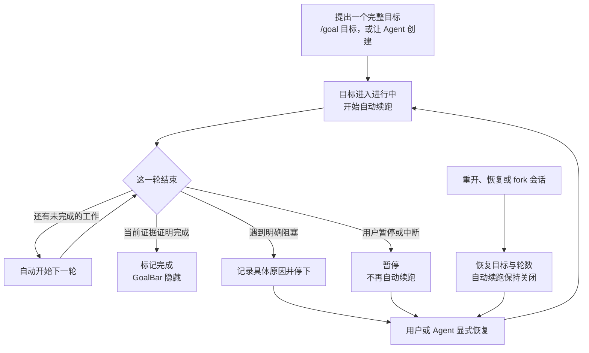
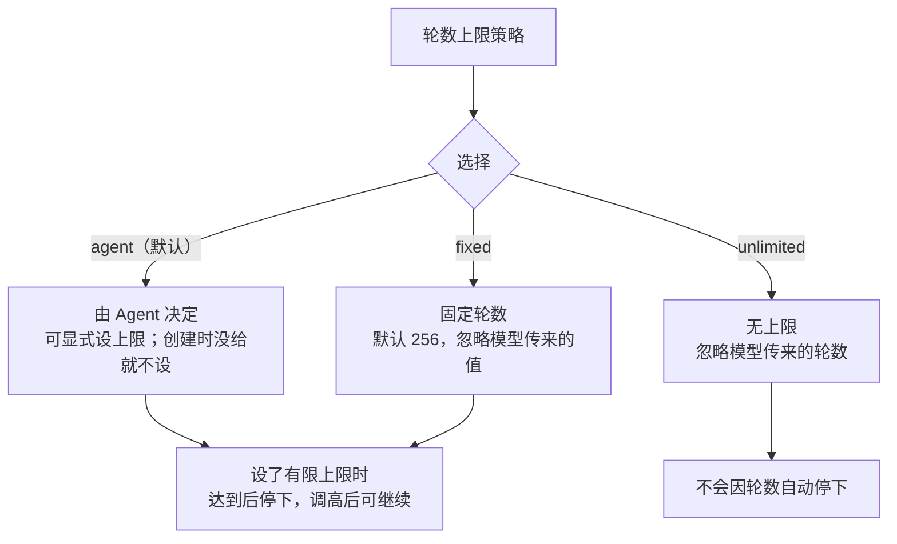

<div align="center">

<h1>dsh-better-goal</h1>

<p><strong>让 DSH 记住一个目标，并自动把后面的回合接下去。</strong></p>

<p>一个会话一个持久目标：自动续跑、三档轮数上限，以及不会把超时当同意的提问等待。步骤仍然交给 <code>todo_write</code>。</p>

<p>
  <a href="LICENSE"></a>
  <a href="package.json"></a>
  <a href="package.json">=24.0.0"></a>
</p>

</div>

> **目标管“要完成什么”，`todo_write` 管“下一步做什么”。** 两者分开，长任务不会只剩一页待办，目标也不会在重开后消失。

## 功能对照：普通对话 vs. 持久目标

| 能力 | 普通对话 | 使用 dsh-better-goal |
| --- | --- | --- |
| 跨轮推进 | 一轮结束就停下来等你再说 | 目标未完成时，自动接下一轮 |
| 恢复与 fork | 目标主要靠对话记忆 | 目标按会话持久保存，重开或 fork 后仍能恢复 |
| 步骤管理 | 总目标和待办容易混在一起 | 一个持久目标；步骤继续用 `todo_write` |
| 轮数控制 | 没有统一旋钮 | `agent` / `unlimited` / `fixed` 三档策略 |
| 提问等待 | 可能一直等下去 | 超过时限转为待回答，问题仍能回答，且不算同意 |

它不是更强的待办清单，而是给会话加一个**可恢复、可暂停、可继续的总目标**。

## 安装：只选一个入口

需要 [DSH](https://github.com/deepseek-ai/deepseek-harness) `>=0.2.1-rc.2 <0.3.0` 和 Node.js `^22.19.0 || >=24.0.0`。无构建步骤。

### 已经用 Apollo（推荐）

[Apollo](https://github.com/Menghuan1918/dsh-apollo) 已经把 `dsh-better-goal` 作为依赖装配，因此**不需要再安装一次**。只保留 Apollo 入口即可；目标设置会出现在 **Plugins → dsh-apollo → dsh-better-goal 行**。

Apollo 是包含流程技能、工程模式和本插件的集合，goal 是其中一个独立子插件。

### 只想要持久目标（独立安装）

```sh
dsh plugin --profile <profile> add github:Menghuan1918/dsh-better-goal
```

这是从 GitHub `main` 安装。完成后，目标设置出现在 **Plugins → dsh-better-goal → dsh-better-goal 行**。

> **安装或升级后要重启对应的 DSH profile。** 刷新网页只会重载界面，不会替换正在运行的实现；插件也不会自动修改你当前打开的 GUI。

本地开发安装见[开发文档](docs/DEVELOPMENT.md)。

## 用起来

典型流程：



计划模式或待提交选择期间，自动轮次会先让路；等待提问、还有子代理在运行时也不会抢跑。你打断当前回合时，进行中的目标会停在暂停状态，而不是自己重新启动。

### Agent 侧：五个动作

模型侧只用一个 `goal` 工具，你不需要记调用格式，也没有内部编号要填：

| 动作 | 用户语义 |
| --- | --- |
| `get` | 读取当前目标、状态和进度 |
| `set` | 用完整目标替换当前目标；轮数清零并立即开始 |
| `resume` | 继续现有目标；保留目标和已用轮数 |
| `complete` | 在当前证据证明完成时结束目标 |
| `fail` | 记录具体阻塞原因并停止 |

只在确实要替换总目标时用 `set`；不要用它绕过轮数上限或丢掉未完成的范围。暂停和清除仍可通过 GoalBar 或 `/goal` 命令完成，它们不是模型侧五个动作的一部分。

### 人类命令

| 你想做 | 命令 |
| --- | --- |
| 开始或整体替换目标 | `/goal <目标>` 或 `/goal set <目标>` |
| 查看当前目标和进度 | `/goal` |
| 修改目标内容（保留进度） | `/goal edit <新目标>` |
| 暂停 / 恢复 | `/goal pause` / `/goal resume` |
| 暂停 / 恢复的短别名 | `/goal off` / `/goal on` |
| 标记完成 | `/goal complete` |
| 报告阻塞原因 | `/goal fail <原因>` |
| 清除目标 | `/goal clear` |

例如：

```text
/goal 给导出接口补上分页，并用现有测试证明没有回归
# Agent 自动接续；需要你决定时会提问
/goal pause
/goal resume
```

`/goal` 命令由插件直接提供，不依赖模型是否记得调用工具。`/goal create <目标>` 是 `/goal set` 的显式别名。编辑一个已经完成的目标会新建目标；旧目标仍保留在会话历史里。

### GoalBar

输入框上方会出现目标条，显示当前状态、目标摘要和 `第 n / 上限 轮`。暂停、恢复、编辑和清除按钮会按当前状态出现；完成的目标会自动隐藏。

> 目标条不负责新建或整体替换目标：用 `/goal <目标>`（或 `/goal set <目标>`），或让 Agent 设定。

## 设置

打开 **Plugins → dsh-better-goal → dsh-better-goal 行**；由 Apollo 装配时，打开 **Plugins → dsh-apollo → dsh-better-goal 行**。两处操作同一份配置。保存后立即生效，不需要重启。

### 默认设置速览

| 设置与默认值 | 说明 |
| --- | --- |
| **轮数上限策略**<br>`roundLimitMode`<br>默认 **`agent`**（由 Agent 决定） | 默认让 Agent 决定；创建时没有给上限，就不设轮数上限。 |
| **固定轮数上限**<br>`roundLimit`<br>默认 **`256`** | 只在“固定轮数”模式生效；达到后停止自动续跑。 |
| **目标提问超时（秒）**<br>`questionTimeoutSeconds`<br>默认 **`120`** | `-1` 永不超时；只影响新提问，正在等待的问题保持原期限。 |

> **默认组合：`agent` + `256` + `120` 秒。** 其中 `256` 只在切到“固定轮数”后生效，`120` 秒只影响目标进行中的新提问。

设置只影响之后的新轮次和新提问：不重置已用轮数，也不会自动恢复已经停下的目标。

### 轮数上限：三种模式



- **`agent`（默认）**：Agent 可以给目标设一个轮数上限；新建时没给就不设上限，编辑或恢复时没给则沿用原值。
- **`unlimited`**：统一无上限，模型传入的轮数会被忽略。
- **`fixed`**：统一使用设置里的固定值（默认 `256`），模型传入的轮数会被忽略。

达到上限时，目标会变为受阻并停止自动续跑。把上限调高后，可以 `/goal resume` 继续；把上限调到已用轮数以下不会让计数倒退，只会让运行中的目标停下。

### 提问超时

- 默认等待 **120 秒**；设为 `-1` 表示永不超时。
- 只在目标进行中、且自动续跑开启时接管**本来就存在**的 `ask_user_question`；不会给“无提问”预设新增提问工具。
- 超时后，问题仍然是**待回答**：之后仍可回答，Agent 也可以先做不依赖答案的工作。**超时不是同意，也不是跳过。**
- 修改设置只影响新发起的等待；已经开始等待的问题保留原期限。

## 恢复、暂停与完成

| 状态 | GoalBar 与续跑 | 怎么继续 |
| --- | --- | --- |
| 进行中 | 显示“进行中的目标”；自动续跑开启 | 等它推进，或随时暂停 / 编辑 |
| 已暂停 | 显示“已暂停的目标”；自动续跑关闭 | 点恢复或 `/goal resume` |
| 受阻 | 显示“受阻的目标”和原因；自动续跑关闭 | 处理阻塞后 `/goal resume`，或编辑目标 |
| 已完成 | 目标条隐藏；自动续跑关闭 | 需要新目标时 `/goal <目标>` |

- **重开、恢复或 fork**：恢复目标、状态和已用轮数，但自动续跑保持关闭；必须显式恢复。
- **用户中断**：停止自动续跑，并在安全的回合边界保存为暂停；不会把暂停通知当成新提示自动启动。
- **计划模式**：计划模式或待提交的选择不会自动续跑。
- **完成**：Agent 会按目标逐项核对当前文件、命令结果、测试和运行状态；局部进度或“应该可以”不算完成证据。你也可以用 `/goal complete` 直接标记完成。
- **失败**：遇到明确阻塞时，Agent 会带着具体原因立即停下，不会为了凑轮数继续空转。

## FAQ

<details>
<summary><strong>我已经用 Apollo，还要再装一次吗？</strong></summary>

不用。Apollo 已经把本插件作为依赖装配，只保留 Apollo 入口即可。两者都被显式选中时，DSH 0.2.1-rc.2 可能把目标设置行锁成只读；**推荐只保留 Apollo 入口**。技术原因见[开发文档](docs/DEVELOPMENT.md)。

</details>

<details>
<summary><strong>设置在哪里？保存后要重启吗？</strong></summary>

独立安装时在 **Plugins → dsh-better-goal → dsh-better-goal 行**；由 Apollo 装配时在 **Plugins → dsh-apollo → dsh-better-goal 行**。三个运行时设置保存后立即生效，不需要重启。安装、升级或改动插件组合后仍需重启 DSH profile。

</details>

<details>
<summary><strong>重开或 fork 后，为什么没有自动继续？</strong></summary>

这是有意的安全行为。会话重开、恢复或 fork 只恢复目标和轮数，不会自动续跑。你可以点 GoalBar 的恢复按钮、执行 `/goal resume`，或由 Agent 明确调用“继续”动作；不要求必须由人类恢复。

</details>

<details>
<summary><strong>提问超时是不是等于同意或跳过？</strong></summary>

不是。超时只表示这一批回答还没到；问题仍可回答，Agent 不应把超时当成授权或默认选项。真正被答案阻塞时，Agent 应报告失败并等你处理，而不是伪造答案。

</details>

<details>
<summary><strong>达到轮数上限后怎么办？</strong></summary>

把轮数上限调高，或切换到无上限，再执行 `/goal resume`。如果目标是“固定轮数”模式，直接提高“固定轮数上限”即可；已经用掉的轮数不会被重置。

</details>

<details>
<summary><strong>为什么安装后当前页面没有变化？</strong></summary>

安装或升级改变的是 DSH 进程加载的插件。刷新网页只会重载界面，不会替换正在运行的实现；请重启对应的 DSH profile。插件也不会自动修改你当前打开的 GUI。

</details>

<details>
<summary><strong>怎么卸载？</strong></summary>

独立安装时执行：

```sh
dsh plugin --profile <profile> remove dsh-better-goal
```

如果 Apollo 仍在装配这一行，移除独立包不会移除 Apollo 插入的目标行；要彻底移除 goal 能力，需要同时移除 Apollo，或显式禁用该行，然后重启 profile。卸载不会清空已有会话记录。

</details>

<details>
<summary><strong>原来的目标数据会丢吗？</strong></summary>

不会因为安装、升级或卸载插件而清空会话记录。旧目标会继续保存在会话里；重新安装后可以恢复，恢复执行前仍需要显式恢复。更多兼容与回退细节见[开发文档](docs/DEVELOPMENT.md)。

</details>

## 开发与许可

- [开发文档](docs/DEVELOPMENT.md)：数据兼容、双入口限制、测试与真实 DSH 冒烟、卸载回退。
- 许可证：[GPL-3.0](LICENSE)。移植的 DeepSeek Harness 代码保留 MIT 声明，见[第三方声明](third-party/NOTICE)和 [MIT 许可证](third-party/LICENSE-MIT-dsh)。
- 项目地址：[Menghuan1918/dsh-better-goal](https://github.com/Menghuan1918/dsh-better-goal)。
