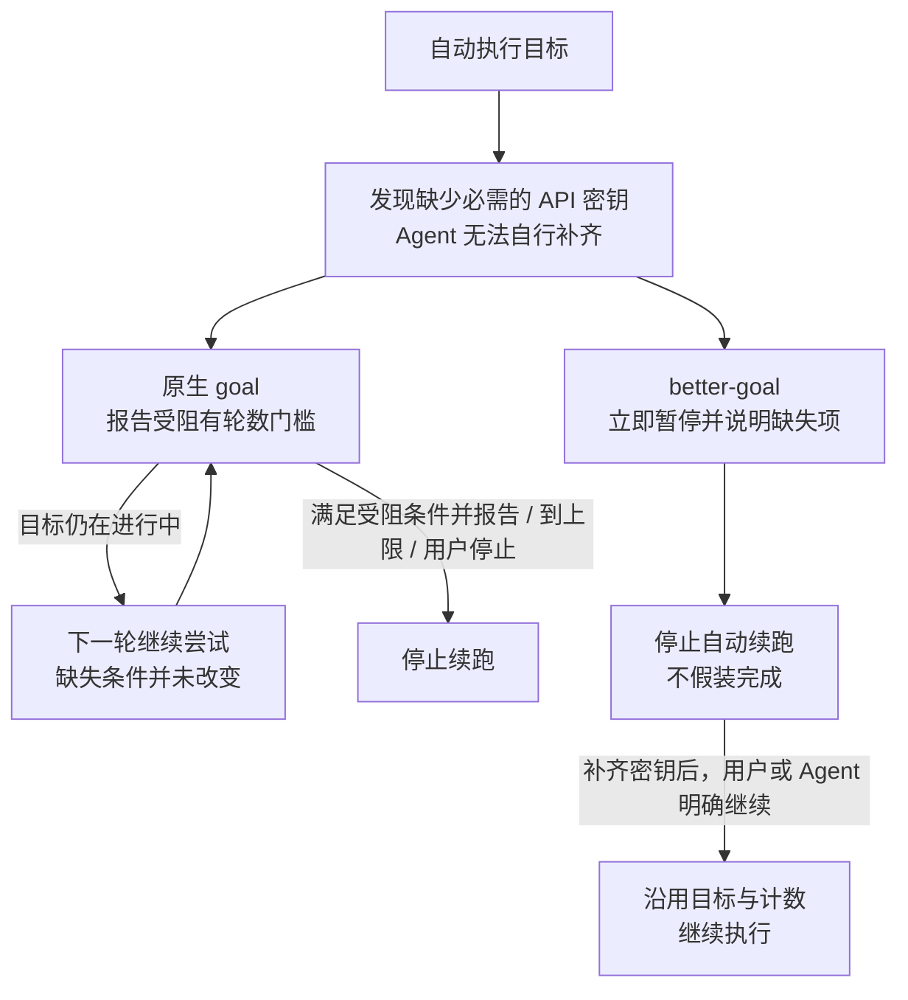
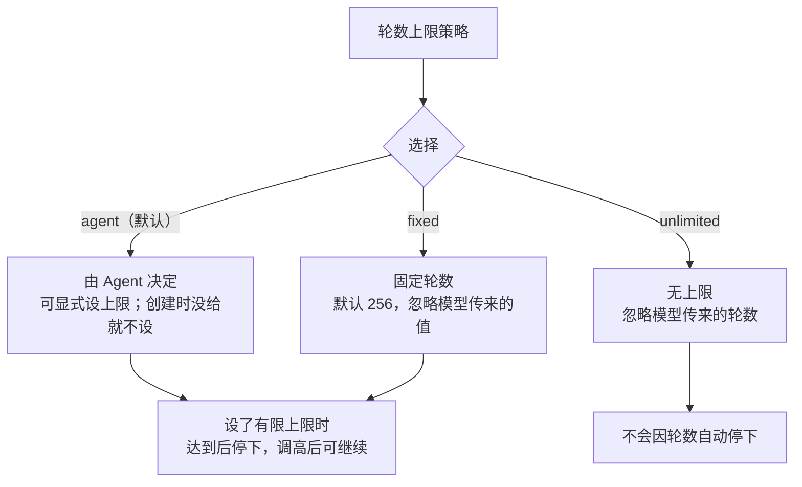

<div align="center">

<h1>dsh-better-goal</h1>

<p><strong>让目标持续推进，也能在必须人介入时明确停下。</strong></p>

<p>替换 DSH 原生 goal：保留持久目标与自动续跑，补上即时失败停止、可控的提问等待和更简单的目标操作。步骤仍然交给 <code>todo_write</code>。</p>

<p>
  <a href="https://www.npmjs.com/package/dsh-better-goal"></a>
  <a href="LICENSE"></a>
  <a href="package.json"></a>
  <a href="package.json">=24.0.0"></a>
</p>

</div>

> **目标管“要完成什么”，`todo_write` 管“下一步做什么”。** 两者分开，长任务不会只剩一页待办，目标也不会在重开后消失。

## 与 DSH 原生 goal 对比

**自动续跑不应该变成“明知做不了，还继续跑”。** 原生 goal 已经提供持久目标与自动续跑；better-goal 改进的是遇到阻塞时及时停下、可控的提问等待，以及更简单的目标操作。

> 对比以 DSH `0.2.1-rc.2` 的默认行为为基准。原生也支持完成、用户暂停和清除，并非完全不能停止；关键差异是**自主续跑中的模型能否在需要人介入时立即暂停**。

| 场景 | DSH 原生 goal | dsh-better-goal |
| --- | --- | --- |
| **缺密钥、缺权限，必须由人介入** | 自主续跑时不能直接自行暂停；报告受阻有轮数门槛，目标仍在进行中就会继续排下一轮 | 立即 `pause`，在回复里说明缺什么，停止自动续跑；不会为了“完成”而伪造、跳过或缩小范围 |
| **阻塞已经确认，还要不要凑轮数** | 自主续跑时，默认至少经过 **3 个目标轮次**才接受受阻报告；刚开始就确认缺密钥，也不能立即用它停下 | 不设这个门槛；明确无法自行解决时即可停下，不必重复空转 |
| **向用户提问后没人回答** | 默认提问会阻塞当前执行；需另行启用定时提问模式才有超时 | 由独立的 **dsh-better-ask-user** 统一管理提问等待；超时后仍可回答，Agent 可先做不依赖答案的工作 |
| **希望始终等人确认** | 默认阻塞等待；定时模式另外配置 | 在 **dsh-better-ask-user** 设置中把等待设为 **`-1`**，即可一直等待；超时从不代表同意 |
| **阻塞解除后继续** | 模型恢复受直接人类请求限制；已暂停目标由 Web 或 `/goal resume` 恢复 | 用户或 Agent 都可明确继续，不要求先出现一条新的人类消息；保留原目标与已用轮数 |
| **轮数控制** | 默认每个目标上限 **256 轮**，达到配置上限会停止；但有限的重试额度不等于能够立即报告阻塞 | **Agent 决定 / 无上限 / 固定数字**三档策略；主动暂停与轮数上限分开处理 |
| **模型如何管理目标** | 分散在 3 个工具中，操作还受状态与授权条件限制 | 一个工具、五个动作：**获取 / 覆盖写入 / 暂停 / 成功 / 继续** |

两者都能保存目标、跨轮推进、暂停和恢复；**这些不是本插件独有的能力**。提问等待已拆到独立的 **dsh-better-ask-user**，本插件只负责目标、续跑与轮数策略。

### 例子：任务卡在必需的 API 密钥

如果后续步骤必须请求外部服务，而当前没有可用密钥，Agent 不能靠“再努力一轮”把密钥变出来。**应当先说明缺失项并停下，而不是反复请求、重复验证，或把未完成的任务标成成功。**

原生默认行为下，这里容易落入两种困境：

- **没有成功报告受阻**：目标仍在进行中，回合结束后继续排下一轮，缺失的密钥却不会因此出现。
- **改为提问等待**：默认会卡在当前提问上，直到用户回答或中止；即使还有独立工作能做，也不能先从这次等待返回。轮数上限不是等待超时，不能解决这个问题。



原生并不一定无限循环：报告受阻、达到轮数上限或用户停止都能结束续跑。这里要避免的是**在无法改变的阻塞上继续消耗回合**；如果还有可以独立推进的有效工作，Agent 应先完成那些工作，再判断是否需要停下。

## 安装：只选一个入口

需要 [DSH](https://github.com/deepseek-ai/deepseek-harness) `>=0.2.1-rc.2 <0.3.0` 和 Node.js `^22.19.0 || >=24.0.0`。无构建步骤。

### 通过 Apollo 安装（推荐）

[Apollo](https://github.com/Menghuan1918/dsh-apollo)（[npm 包](https://www.npmjs.com/package/@menghuan1918/dsh-apollo)）是包含流程技能、工程模式和本插件的集合，goal 是其中一个独立子插件。从 npm 安装 Apollo 会自动带入 `dsh-better-goal`，**不需要再安装一次**：

```sh
dsh plugin --profile <profile> add @menghuan1918/dsh-apollo@0.4.1
```

安装后，目标设置出现在 **Plugins → @menghuan1918/dsh-apollo → dsh-better-goal 行**。只保留 Apollo 入口即可。

旧版通过 GitHub 安装的 Apollo，在 Plugins 里仍显示为 `dsh-apollo`；迁移到 `@menghuan1918/dsh-apollo` 时先移除旧入口，再安装新包。会话记录保留，`/goal` 用法不变；迁移后请检查插件设置。

### 只安装目标插件（独立安装）

如果不需要 Apollo，可从 npm 单独安装本插件：

```sh
# npm 安装（推荐）
dsh plugin --profile <profile> add dsh-better-goal@0.2.0

# 或从 GitHub main 源码安装（次入口）
dsh plugin --profile <profile> add github:Menghuan1918/dsh-better-goal
```

完成后，目标设置出现在 **Plugins → dsh-better-goal → dsh-better-goal 行**。npm 包页面：[dsh-better-goal](https://www.npmjs.com/package/dsh-better-goal)。

> **安装或升级后要重启对应的 DSH profile。** 刷新网页只会重载界面，不会替换正在运行的实现；插件也不会自动修改你当前打开的 GUI。

本地开发安装见[开发文档](docs/DEVELOPMENT.md)。

## 用起来

典型流程：

```mermaid
flowchart TD
    A["提出一个完整目标<br/>/goal 目标，或让 Agent 创建"] --> B["目标进入进行中<br/>开始自动续跑"]
    B --> C{"这一轮结束"}
    C -->|"还有未完成的工作"| D["自动开始下一轮"]
    D --> C
    C -->|"当前证据证明完成"| E["标记完成<br/>GoalBar 隐藏"]
    C -->|"需要人介入（缺密钥 / 权限 / 决定）"| F["Agent 暂停并说明缺什么"]
    C -->|"用户暂停或中断"| G["暂停<br/>不再自动续跑"]
    F --> H["用户或 Agent 显式恢复"]
    G --> H
    H --> B
    J["重开、恢复或 fork 会话"] --> K["恢复目标与轮数<br/>自动续跑保持关闭"]
    K --> H
```



计划模式或待提交选择期间，自动轮次会先让路；等待提问、还有子代理在运行时也不会抢跑。你打断当前回合时，进行中的目标会停在暂停状态，而不是自己重新启动。

### Agent 侧：五个动作

模型侧只用一个 `goal` 工具，你不需要记调用格式，也没有内部编号要填：

| 动作 | 用户语义 |
| --- | --- |
| `get` | 读取当前目标、状态和进度 |
| `set` | 用完整目标替换当前目标；轮数清零并立即开始 |
| `resume` | 继续现有目标；保留目标和已用轮数 |
| `complete` | 在当前证据证明完成时结束目标 |
| `pause` | 需要你提供密钥、权限或决定时停下；目标保留，可随时继续 |

只在确实要替换总目标时用 `set`；不要用它绕过轮数上限或丢掉未完成的范围。Agent 不会用 mock、硬编码或跳过检查来“完成”目标；缺条件就暂停并说明缺什么。清除仍由 GoalBar 或 `/goal clear` 完成。

> **0.2.0 变更**：模型侧的 `fail` 改为 `pause`。`/goal fail <原因>` 保留为人类命令，会记录原因并标记受阻；历史上由模型记录的受阻目标仍可读取和恢复。

### 人类命令

| 你想做 | 命令 |
| --- | --- |
| 开始或整体替换目标 | `/goal <目标>` 或 `/goal set <目标>` |
| 查看当前目标和进度 | `/goal` |
| 修改目标内容（保留进度） | `/goal edit <新目标>` |
| 暂停 / 恢复 | `/goal pause` / `/goal resume` |
| 暂停 / 恢复的短别名 | `/goal off` / `/goal on` |
| 标记完成 | `/goal complete` |
| 报告阻塞原因（仅人类） | `/goal fail <原因>` |
| 清除目标 | `/goal clear` |

例如：

```text
/goal 给导出接口补上分页，并用现有测试证明没有回归
# Agent 自动接续；需要你决定时会提问
/goal pause
/goal resume
```

`/goal` 命令由插件直接提供，不依赖模型是否记得调用工具。`/goal create <目标>` 是 `/goal set` 的显式别名。编辑一个已经完成的目标会新建目标；旧目标仍保留在会话历史里。

### GoalBar

输入框上方的目标条显示状态、目标摘要和轮数；固定上限还显示进度。点击摘要查看完整目标，编辑时支持多行，使用 Ctrl/⌘ + Enter 保存。暂停、恢复、编辑和清除按钮按状态出现。

完成后收起当前目标，历史入口继续保留。点击历史图标可搜索、按状态筛选并展开已完成或已清除的目标；历史跟随会话恢复。

> 目标条不负责新建或整体替换目标：用 `/goal <目标>`（或 `/goal set <目标>`），或让 Agent 设定。

## 设置

打开 **Plugins → dsh-better-goal → dsh-better-goal 行**；由 `@menghuan1918/dsh-apollo` 装配时，打开 **Plugins → @menghuan1918/dsh-apollo → dsh-better-goal 行**。两处操作同一份配置。增强轮数策略保存后热更新；目标实现和两项原生参数保存后需要重启对应 DSH profile，页面会区分已保存配置与实际运行配置。

### 默认设置速览

| 设置与默认值 | 说明 |
| --- | --- |
| **目标实现**<br>`implementation`<br>默认 **`enhanced`**（增强 Goal） | **`enhanced`**：本插件自己的服务、单一 `goal` 工具、`/goal` 命令与续跑驱动。**`native`**：宿主原生 `dsh-goal` 服务、`get_goal`/`create_goal`/`update_goal` 工具、命令与续跑驱动。两套实现读写同一份目标记录，不会同时运行；切换保存后**重载 profile** 才替换装配。 |
| **原生默认轮数**<br>`nativeDefaultMaxGoalRounds`<br>默认 **`256`** | 只在 `native` 实现生效：调用方未指定轮数时原生服务使用的默认上限。保存后重载 profile 生效。 |
| **原生受阻轮数**<br>`nativeBlockedAfterConsecutiveRounds`<br>默认 **`3`** | 只在 `native` 实现生效：原生自主目标轮次达到该累计轮数后，模型才可报告受阻。保存后重载 profile 生效。 |
| **轮数上限策略**<br>`roundLimitMode`<br>默认 **`agent`**（由 Agent 决定） | 只在 `enhanced` 实现生效：默认让 Agent 决定；创建时没有给上限，就不设轮数上限。 |
| **固定轮数上限**<br>`roundLimit`<br>默认 **`256`** | 只在“固定轮数”模式生效；达到后停止自动续跑。 |
| **旧提问超时字段**<br>`questionTimeoutSeconds` | **已弃用，仅保留读取**；新的等待、续期和超时行为在 **dsh-better-ask-user** 中配置。 |

> **默认组合：`enhanced` + `agent` + `256`。** 其中 `256` 只在切到“固定轮数”后生效。`implementation` 与两个 `native*` 字段是装配时输入：保存写入配置，重载 profile 才换装配；`roundLimitMode`/`roundLimit` 热更新、立即生效。旧配置里的 `120` 秒只用于一次性迁移到 ask-user，不再影响本插件的运行。

增强轮数策略只影响之后的新轮次，不重置已用轮数，也不会自动恢复已经停下的目标。原生模式使用本页的原生参数，增强轮数策略保留但不生效。

### 轮数上限：三种模式



- **`agent`（默认）**：Agent 可以给目标设一个轮数上限；新建时没给就不设上限，编辑或恢复时没给则沿用原值。
- **`unlimited`**：统一无上限，模型传入的轮数会被忽略。
- **`fixed`**：统一使用设置里的固定值（默认 `256`），模型传入的轮数会被忽略。

达到上限时，目标会变为受阻并停止自动续跑。把上限调高后，可以 `/goal resume` 继续；把上限调到已用轮数以下不会让计数倒退，只会让运行中的目标停下。

### 提问等待

提问等待、输入续期、Web 卡片和超时行为已经迁移到独立插件 **dsh-better-ask-user**。本插件不再注册 `ask_user_question` 影子，也不再消费 `questionTimeoutSeconds`；该字段只作为旧配置保留，供 ask-user 做一次性迁移。

超时仍然不是同意，也不是跳过。原生 pending 行为会让问题保持可回答；默认选择模式会把结果明确标记为自动选择，模型侧会收到警告。

## 恢复、暂停与完成

| 状态 | GoalBar 与续跑 | 怎么继续 |
| --- | --- | --- |
| 进行中 | 显示“进行中的目标”；自动续跑开启 | 等它推进，或随时暂停 / 编辑 |
| 已暂停 | 显示“已暂停的目标”；自动续跑关闭 | 点恢复或 `/goal resume` |
| 受阻 | 显示“受阻的目标”和原因；自动续跑关闭 | 处理阻塞后 `/goal resume`，或编辑目标 |
| 已完成 | 目标条隐藏；自动续跑关闭 | 需要新目标时 `/goal <目标>` |

- **重开、恢复或 fork**：恢复目标、状态和已用轮数，但自动续跑保持关闭；必须显式恢复。
- **用户中断**：停止自动续跑，并在安全的回合边界保存为暂停；不会把暂停通知当成新提示自动启动。
- **计划模式**：计划模式或待提交的选择不会自动续跑。
- **完成**：Agent 会按目标逐项核对当前文件、命令结果、测试和运行状态；局部进度或“应该可以”不算完成证据。你也可以用 `/goal complete` 直接标记完成。
- **失败**：遇到明确阻塞时，Agent 会带着具体原因立即停下，不会为了凑轮数继续空转。

## FAQ

<details>
<summary><strong>我已经用 Apollo，还要再装一次吗？</strong></summary>

不用。Apollo 已经把本插件作为依赖装配，只保留 Apollo 入口即可。两者都被显式选中时，DSH 0.2.1-rc.2 可能把目标设置行锁成只读；**推荐只保留 Apollo 入口**。技术原因见[开发文档](docs/DEVELOPMENT.md)。

</details>

<details>
<summary><strong>设置在哪里？保存后要重启吗？</strong></summary>

独立安装时在 **Plugins → dsh-better-goal → dsh-better-goal 行**；由 `@menghuan1918/dsh-apollo` 装配时在 **Plugins → @menghuan1918/dsh-apollo → dsh-better-goal 行**。增强轮数策略保存后热更新；`implementation` 和两项 `native*` 参数保存后需要重启 DSH profile。刷新网页不会替换运行中的实现。安装、升级或改动插件组合后也需重启 profile。

</details>

<details>
<summary><strong>重开或 fork 后，为什么没有自动继续？</strong></summary>

这是有意的安全行为。会话重开、恢复或 fork 只恢复目标和轮数，不会自动续跑。你可以点 GoalBar 的恢复按钮、执行 `/goal resume`，或由 Agent 明确调用“继续”动作；不要求必须由人类恢复。

</details>

<details>
<summary><strong>提问超时是不是等于同意或跳过？</strong></summary>

不是。超时只表示这一批回答还没到；问题仍可回答，Agent 不应把超时当成授权或默认选项。真正被答案阻塞时，Agent 应报告失败并等你处理，而不是伪造答案。具体的等待与默认选择规则见 **dsh-better-ask-user**。

</details>

<details>
<summary><strong>达到轮数上限后怎么办？</strong></summary>

把轮数上限调高，或切换到无上限，再执行 `/goal resume`。如果目标是“固定轮数”模式，直接提高“固定轮数上限”即可；已经用掉的轮数不会被重置。

</details>

<details>
<summary><strong>为什么安装后当前页面没有变化？</strong></summary>

安装或升级改变的是 DSH 进程加载的插件。刷新网页只会重载界面，不会替换正在运行的实现；请重启对应的 DSH profile。插件也不会自动修改你当前打开的 GUI。

</details>

<details>
<summary><strong>怎么卸载？</strong></summary>

独立安装时执行：

```sh
dsh plugin --profile <profile> remove dsh-better-goal
```

如果 Apollo 仍在装配这一行，移除独立包不会移除 Apollo 插入的目标行；要彻底移除 goal 能力，需要同时移除 Apollo，或显式禁用该行，然后重启 profile。卸载不会清空已有会话记录。

</details>

<details>
<summary><strong>原来的目标数据会丢吗？</strong></summary>

不会因为安装、升级或卸载插件而清空会话记录。旧目标会继续保存在会话里；重新安装后可以恢复，恢复执行前仍需要显式恢复。更多兼容与回退细节见[开发文档](docs/DEVELOPMENT.md)。

</details>

## 开发与许可

- [开发文档](docs/DEVELOPMENT.md)：数据兼容、双入口限制、测试与真实 DSH 冒烟、卸载回退。
- 许可证：[Apache-2.0](LICENSE)。移植的 DeepSeek Harness 代码保留 MIT 声明，见[第三方声明](third-party/NOTICE)和 [MIT 许可证](third-party/LICENSE-MIT-dsh)。
- 项目地址：[Menghuan1918/dsh-better-goal](https://github.com/Menghuan1918/dsh-better-goal)。
